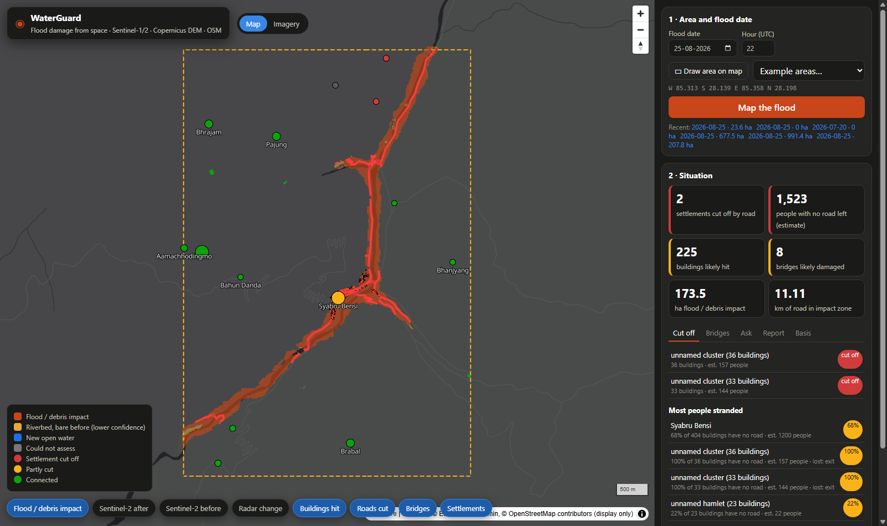
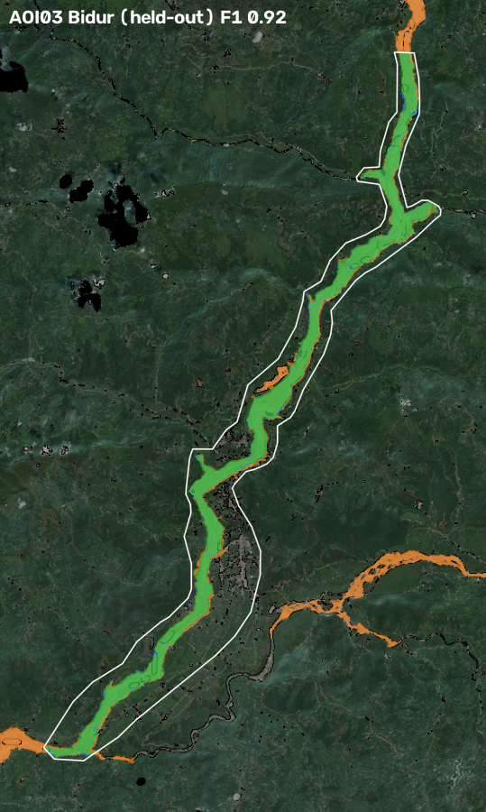

<div align="center">

# 🌊🛰️ WaterGuard

### *Floods from space, answers for the ground.*

Point at a map, pick a date, and WaterGuard tells rescue teams **where the flood hit, what it broke, and who is now cut off**, using nothing but free satellite data.

[](https://youtu.be/4vqE-tZAP90)
[](#-run-it-yourself)


<a href="https://youtu.be/4vqE-tZAP90"></a>

*▶ Click to watch the film*

</div>

---

## 🤔 The problem

When a glacier lake bursts in the Himalaya, the clouds don't part politely for your satellite. Roads vanish, bridges go downstream, and the first question from every rescue team is the same: **"Which villages can we still reach?"**

WaterGuard answers that in minutes, not days.

## ✨ What it does

| | Question | How WaterGuard answers |
|---|---|---|
| 🌊 | **Where did the flood hit?** | Sentinel-1 radar (sees straight through monsoon cloud) + Sentinel-2 optical change, kept to the valley floor where water can actually reach (Copernicus DEM) |
| 🏚️ | **What was damaged?** | Buildings, roads, bridges and health facilities from **pre-event** OpenStreetMap, laid over the impact map |
| 🚧 | **Who is cut off?** | Settlements that had a road to a town, a health post or the wider network *before* the flood and have none now |
| 💬 | **"So what do I tell my team?"** | A bilingual copilot (English + नेपाली) that won't say a number the maps can't back up |
| 📄 | **"I need it on paper."** | A one-page situation report, one click |
| 🧭 | **"Where will it go next?"** | A flood-path tracer from any upstream point |



## 🏔️ The case study

The **26 Aug 2026 glacier-outburst flood** on the Bhote Koshi–Trishuli corridor in Nepal, checked against the official Copernicus EMS damage maps (**EMSR927**).

The twist: this flood was mostly **debris and landslides, not open water**. A normal "find the water" model would miss most of it, so WaterGuard looks for *change* instead.

## 📊 How well does it work?

We tuned on two EMS areas and kept the other two **held out**, so no peeking. "Valley-only" is a lazy baseline that marks the whole valley floor as hit; the gap shows what the satellites actually add.

| EMS area | Split | F1 | Precision | Recall | Valley-only F1 | EMS destroyed buildings we caught | EMS damaged bridges we flag |
|---|---|---|---|---|---|---|---|
| AOI01 Syapru Besi | tuning | 0.94 | 0.95 | 0.93 | 0.86 | 322/323 | 5/5 |
| AOI02 Timure | tuning | 0.90 | 0.98 | 0.83 | 0.89 | 360/372 | (none in OSM) |
| AOI03 Bidur | **held-out** | **0.92** | 0.87 | 0.97 | 0.56 | 2475/2479 | 20/20 |
| AOI05 Phosretar | **held-out** | **0.88** | 0.95 | 0.82 | 0.53 | 358/397 | 11/13 |

**Does it cry wolf?** 🐺 We tried to make it:

- 📅 **Placebo date** (same area, a month before the flood): **0 ha** flagged
- 🏞️ **Untouched Langtang valley**: **0 ha**
- 🌿 **Tadi Khola tributary**: 23.6 ha, **0 buildings**

**Does it travel?** It ran unchanged on the **Melamchi 2021** flood (it spots Melamchi Bazar losing road access to its health post) and on the **Kathmandu Valley floods of Sept 2024**, a flat city that couldn't be more different from a Himalayan gorge.



📘 Full tables, figures and method: [docs/REPORT.pdf](docs/REPORT.pdf)

## 🚀 Run it yourself

```bash
python -m venv .venv
.venv\Scripts\activate                 # Windows  (Linux/macOS: source .venv/bin/activate)
pip install -r requirements.txt
copy .env.example .env                  # add OHSOME_API_KEY (free: https://account.heigit.org/signup)

python -m waterguard.server             # 🗺️ dashboard on http://localhost:8000
```

Draw a box (or pick an example), set the flood date, and hit **Map the flood**. The first run over ~30 km² takes 3–5 minutes, almost all of it spent downloading imagery. Reruns come from the local cache in seconds. ☕

Prefer the terminal? Any area, any date:

```bash
python -m waterguard.pipeline --bbox 85.313 28.139 85.358 28.198 --date 2026-08-25T22:00Z
```

Everything lands in `data/runs/<run_id>/`: `facts.json` (every number, with where it came from), `impact.tif`, and GeoJSON layers for impact, buildings, bridges, roads cut, settlements and health facilities.

**Copilot brain** (optional; with none configured, a deterministic offline router answers from the same tools):

| Backend | Set in `.env` |
|---|---|
| Amazon Bedrock (default: Amazon Nova Pro) | AWS credentials, `WATERGUARD_LLM=bedrock`, optional `BEDROCK_MODEL` |
| Any OpenAI-compatible API | `OPENAI_API_KEY`, `OPENAI_BASE_URL`, `OPENAI_MODEL` |
| Offline | `WATERGUARD_LLM=offline` |

**Check our homework** against EMSR927:

```bash
python scripts/fetch_emsr927.py         # downloads the EMS reference vectors to data/validation/
python -m waterguard.validate           # scores AOI01, 02, 03, 05 + the false-alarm tests
python -m pytest tests/test_core.py -q  # offline unit tests
```

## 🧠 How it works

```
area + date
  ├─ 🏔️ Copernicus DEM GLO-30 ─ WhiteboxTools ─ HAND (height above river), slope, aspect, D8 flow
  ├─ 📡 Sentinel-1 RTC, every orbit track: first image after the event vs up to 5 earlier images of the
  │    SAME track -> per-pixel |z| change (OpenCV multilook), radar layover/shadow masked
  ├─ 🛰️ Sentinel-2 L2A: per-pixel cloud-free composites before/after (SCL mask) -> NDVI loss, NDWI gain
  ├─ 🔀 fusion (OpenCV): valley floor (HAND <= 80 m) AND (optical change where clear, radar elsewhere)
  │    -> morphology, patches must touch the river, riverbed/gravel growth from >= 5 ha seeds (not through mapped buildings)
  ├─ 🗺️ OpenStreetMap snapshot 24 h BEFORE the event (ohsome API), audited: 0 features edited after it
  ├─ 🏚️ damage: buildings / bridges / health on or within 20 m of impact; road km inside impact
  ├─ 🚧 access: road graph (vehicle and foot), impacted segments and damaged bridges removed; up to 25
  │    buildings per settlement test reachability to towns, health facilities and roads leaving the
  │    area -> cut off / partly cut, share of buildings with no road, people stranded (estimate)
  └─ 📦 facts.json -> dashboard, one-page report (EN/NE), copilot
```

| Module | What it does |
|---|---|
| `waterguard/providers/` | Scene search and reads: Microsoft Planetary Computer (primary), Meru Labs (fallback); same-track pairing |
| `waterguard/terrain.py` | DEM, HAND, slope/aspect, D8; radar layover/shadow geometry |
| `waterguard/sar.py` | Sentinel-1 temporal z-score change, new open water |
| `waterguard/optical.py` | Sentinel-2 cloud-free composites, NDVI/NDWI change |
| `waterguard/detect.py` | Evidence fusion into the impact map |
| `waterguard/osm.py` | Pre-event OSM snapshot and provenance audit |
| `waterguard/damage.py` | Damage overlay |
| `waterguard/access.py` | Cut-off settlement analysis |
| `waterguard/flowpath.py` | Flood path from any upstream point |
| `waterguard/copilot.py` | Copilot, tools, number verifier, LLM backends |
| `waterguard/sitrep.py` | One-page report (EN/NE), offline copilot |
| `waterguard/validate.py` | EMSR927 comparison and false-alarm tests (the only code that reads EMS data) |
| `waterguard/server.py`, `web/` | Dashboard (FastAPI + MapLibre) |

## 💬 The copilot that can't make things up

Ask it *"Which villages are cut off?"*, *"What about Syabru Bensi?"* or *"कुन कुन पुल भत्किए?"* and it answers, or writes a short situation report, in English or Nepali.

- 🙅 **It has no data of its own.** It can only call six read-only tools over the run's results: overview, cut-off list, settlement status, damaged bridges, health facilities and the flood-path tracer.
- 🔢 **Every number gets fact-checked.** Each number in a draft (ASCII or Devanagari digits) must appear in a tool result from that conversation. If one doesn't, the model gets one retry with the offenders listed. Still wrong? Those numbers become `[unverified]` and the UI shows a warning. Every answer ends with "✓ N numbers checked".
- 🗺️ **It drives the map.** Answers fly to the named place, mark bridges and draw flood paths.
- 📄 **The one-page report is template-based**, so its numbers are exactly the pipeline's.

## 🛡️ Data rules we hold ourselves to

| Input | Used for |
|---|---|
| Sentinel-1 RTC | Change detection (all orbit tracks, same-track pairs only) |
| Sentinel-2 L2A | Change detection where clear; true-colour layers on the dashboard |
| Copernicus DEM GLO-30 | HAND, slope, layover/shadow, flow paths |
| OpenStreetMap before the event (ohsome API) | Buildings, roads, bridges, settlements, health facilities |

**Never used as inputs:** Copernicus EMS, UNOSAT or any other damage maps, or OSM edits made after the event. Every run's OSM snapshot is taken 24 h before the event and audited, and the run fails if any feature was edited later. EMS maps are read **only** by `waterguard/validate.py`, which the pipeline never imports. No training dataset is used. Population is estimated as buildings × 4.37 (Nepal 2021 census average household size), and that assumption is stated wherever the number appears. Dashboard basemaps (Esri) are for display only.

> ⚠️ **Educational prototype, not an operational tool.** Please read the limitations in [docs/REPORT.md](docs/REPORT.md) before trusting it with anything that matters.

## 🙏 Attribution

- Contains modified Copernicus Sentinel data 2026.
- Produced using Copernicus WorldDEM-30 © DLR e.V. 2010–2014 and © Airbus Defence and Space GmbH 2014–2018 provided under COPERNICUS by the European Union and ESA; all rights reserved.
- © OpenStreetMap contributors (ODbL). Published modifications of OSM data remain under ODbL.
- Validation only: European Union, Copernicus Emergency Management Service data (EMSR927).
- Data access: Microsoft Planetary Computer; ohsome API (HeiGIT); Meru Labs API (fallback).
- WhiteboxTools (Lindsay, 2016), OpenCV, MapLibre GL JS.

## 📜 License

MIT, see [`LICENSE`](LICENSE). Go build something that helps. 💙
