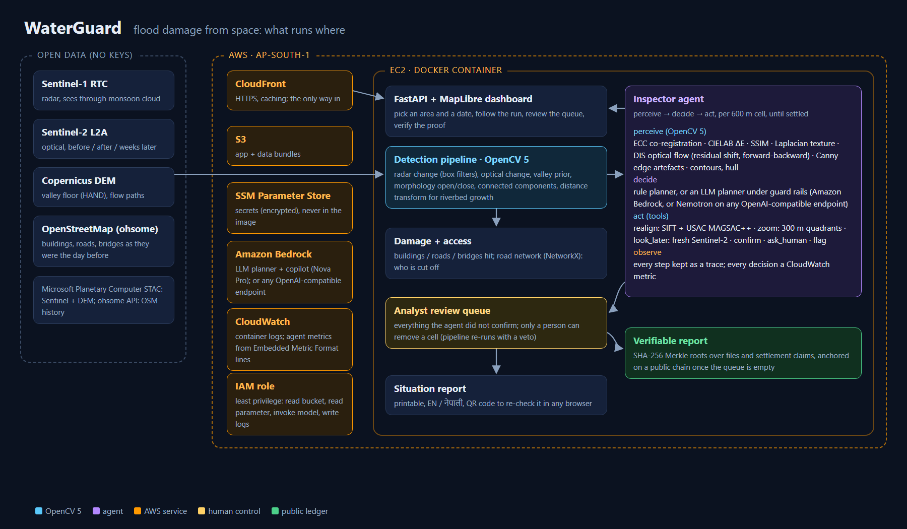
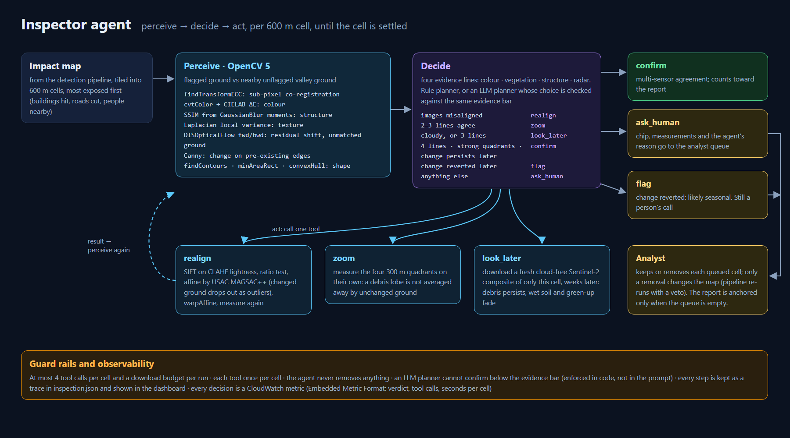

<div align="center">

# 🌊🛰️ WaterGuard

### *Floods from space, answers for the ground.*

Point at a map, pick a date, and WaterGuard tells rescue teams **where the flood hit, what it broke, and who is now cut off**, using nothing but free satellite data.

[](https://youtu.be/hokCtf0--9I)
[](https://d1sgb39rsg0dlm.cloudfront.net)


<a href="https://youtu.be/hokCtf0--9I"></a>

*▶ Click to watch the film (2:44) · the [full walkthrough](https://youtu.be/YzmJV0aTBeM) (4:33) adds how the agent uses OpenCV 5, the stress test and the verifiable reports*

</div>

---

## 🤔 The problem

When a glacier lake bursts in the Himalaya, the clouds don't part politely for your satellite. Roads vanish, bridges go downstream, and the first question from every rescue team is the same: **"Which villages can we still reach?"**

WaterGuard answers that in minutes, not days.

## ✨ What it does

| | Question | How WaterGuard answers |
|---|---|---|
| 🌊 | **Where did the flood hit?** | Sentinel-1 radar (sees straight through monsoon cloud) + Sentinel-2 optical change, kept to the valley floor where water can actually reach (Copernicus DEM) |
| 🏚️ | **What was damaged?** | Buildings, roads, bridges and health facilities from **pre-event** OpenStreetMap, laid over the impact map |
| 🚧 | **Who is cut off?** | Settlements that had a road to a town, a health post or the wider network *before* the flood and have none now |
| 💬 | **"So what do I tell my team?"** | A bilingual copilot (English + नेपाली) that won't say a number the maps can't back up |
| 📄 | **"I need it on paper."** | A one-page situation report, one click |
| 🧭 | **"Where will it go next?"** | A flood-path tracer from any upstream point |


## 🏔️ The case study

The **26 Aug 2026 glacier-outburst flood** on the Bhote Koshi–Trishuli corridor in Nepal, checked against the official Copernicus EMS damage maps (**EMSR927**).

The twist: this flood was mostly **debris and landslides, not open water**. A normal "find the water" model would miss most of it, so WaterGuard looks for *change* instead.

## 📊 How well does it work?

We tuned on two EMS areas and kept the other two **held out**, so no peeking. "Valley-only" is a lazy baseline that marks the whole valley floor as hit; the gap shows what the satellites actually add.

| EMS area | Split | F1 | Precision | Recall | Valley-only F1 | EMS destroyed buildings we caught | EMS damaged bridges we flag |
|---|---|---|---|---|---|---|---|
| AOI01 Syapru Besi | tuning | 0.94 | 0.95 | 0.93 | 0.86 | 322/323 | 5/5 |
| AOI02 Timure | tuning | 0.90 | 0.98 | 0.83 | 0.89 | 360/372 | (none in OSM) |
| AOI03 Bidur | **held-out** | **0.92** | 0.87 | 0.97 | 0.56 | 2475/2479 | 20/20 |
| AOI05 Phosretar | **held-out** | **0.88** | 0.95 | 0.82 | 0.53 | 358/397 | 11/13 |

**Does it cry wolf?** 🐺 We tried to make it:

- 📅 **Placebo date** (same area, a month before the flood): **0 ha** flagged
- 🏞️ **Untouched Langtang valley**: **0 ha**
- 🌿 **Tadi Khola tributary**: 23.6 ha, **0 buildings**

**Does it travel?** It ran unchanged on the **Melamchi 2021** flood (it spots Melamchi Bazar losing road access to its health post) and on the **Kathmandu Valley floods of Sept 2024**, a flat city that couldn't be more different from a Himalayan gorge.


📘 Full tables, figures and method: [docs/REPORT.pdf](docs/REPORT.pdf)

## 🚀 Run it yourself

```bash
python -m venv .venv
.venv\Scripts\activate                 # Windows  (Linux/macOS: source .venv/bin/activate)
pip install -r requirements.txt
copy .env.example .env                  # add OHSOME_API_KEY (free: https://account.heigit.org/signup)

python -m waterguard.server             # 🗺️ dashboard on http://localhost:8000
```

Draw a box (or pick an example), set the flood date, and hit **Map the flood**. The first run over ~30 km² takes 3–5 minutes, almost all of it spent downloading imagery. Reruns come from the local cache in seconds. ☕

Prefer the terminal? Any area, any date:

```bash
python -m waterguard.pipeline --bbox 85.313 28.139 85.358 28.198 --date 2026-08-25T22:00Z
```

Everything lands in `data/runs/<run_id>/`: `facts.json` (every number, with where it came from), `impact.tif`, and GeoJSON layers for impact, buildings, bridges, roads cut, settlements and health facilities.

**Copilot and planner models** (optional; with none configured, a deterministic offline router answers from the same tools and the inspector uses its rule planner). Web reports in the copilot need `TAVILY_API_KEY`.

| Backend | Set in `.env` |
|---|---|
| NVIDIA Nemotron on Nebius Token Factory (default when the key is set; see below) | `NEBIUS_API_KEY`, optional `NEBIUS_MODEL`, `NEBIUS_PLANNER_MODEL`, `NEBIUS_VL_MODEL` |
| Amazon Bedrock (Amazon Nova Pro; also the fallback) | AWS credentials, `WATERGUARD_LLM=bedrock`, optional `BEDROCK_MODEL` |
| Any OpenAI-compatible API | `OPENAI_API_KEY`, `OPENAI_BASE_URL`, `OPENAI_MODEL` |
| Offline | `WATERGUARD_LLM=offline` |

**Check our homework** against EMSR927:

```bash
python scripts/fetch_emsr927.py         # downloads the EMS reference vectors to data/validation/
python -m waterguard.validate           # scores AOI01, 02, 03, 05 + the false-alarm tests
python -m pytest tests -q              # offline unit tests + ledger flow on an in-memory EVM
```

## ☁️ Deploy on AWS



The live demo runs on one EC2 `t3.xlarge` (Docker) behind CloudFront for HTTPS; the security group admits only CloudFront. Secrets live in SSM Parameter Store, and the copilot calls Amazon Bedrock through the instance role, so no keys are baked into the image or the repo. Container logs, including the inspector's metric lines, go to CloudWatch (`/waterguard/app`, metrics namespace `WaterGuard/Inspector`). The role can only read the deploy bucket and the `/waterguard/*` parameters, invoke models and write `/waterguard/*` logs.

```bash
# upload app + finished runs/caches to S3 and put your .env in SSM (/waterguard/env), then:
bash deploy/aws_deploy.sh               # IAM role, CloudFront-only security group, EC2, CloudFront
```

`deploy/user-data.sh` is the boot script: it pulls the bundle, builds the `Dockerfile` and serves on port 80. Only one flood run executes at a time (`WATERGUARD_MAX_JOBS`); others wait in a queue.

## 🧠 How it works

```
area + date
  ├─ 🏔️ Copernicus DEM GLO-30 ─ WhiteboxTools ─ HAND (height above river), slope, aspect, D8 flow
  ├─ 📡 Sentinel-1 RTC, every orbit track: first image after the event vs up to 5 earlier images of the
  │    SAME track -> per-pixel |z| change (OpenCV multilook), radar layover/shadow masked
  ├─ 🛰️ Sentinel-2 L2A: per-pixel cloud-free composites before/after (SCL mask) -> NDVI loss, NDWI gain
  ├─ 🔀 fusion (OpenCV): valley floor (HAND <= 80 m) AND (optical change where clear, radar elsewhere)
  │    -> morphology, patches must touch the river, riverbed/gravel growth from >= 5 ha seeds (not through mapped buildings)
  ├─ 🗺️ OpenStreetMap snapshot 24 h BEFORE the event (ohsome API), audited: 0 features edited after it
  ├─ 🏚️ damage: buildings / bridges / health on or within 20 m of impact; road km inside impact
  ├─ 🚧 access: road graph (vehicle and foot), impacted segments and damaged bridges removed; up to 25
  │    buildings per settlement test reachability to towns, health facilities and roads leaving the
  │    area -> cut off / partly cut, share of buildings with no road, people stranded (estimate)
  └─ 📦 facts.json -> dashboard, one-page report (EN/NE), copilot
```

| Module | What it does |
|---|---|
| `waterguard/providers/` | Scene search and reads: Microsoft Planetary Computer (primary), Meru Labs (fallback); same-track pairing |
| `waterguard/terrain.py` | DEM, HAND, slope/aspect, D8; radar layover/shadow geometry |
| `waterguard/sar.py` | Sentinel-1 temporal z-score change, new open water |
| `waterguard/optical.py` | Sentinel-2 cloud-free composites, NDVI/NDWI change |
| `waterguard/detect.py` | Evidence fusion into the impact map |
| `waterguard/osm.py` | Pre-event OSM snapshot and provenance audit |
| `waterguard/damage.py` | Damage overlay |
| `waterguard/access.py` | Cut-off settlement analysis |
| `waterguard/flowpath.py` | Flood path from any upstream point |
| `waterguard/copilot.py` | Copilot, tools, number verifier, LLM backends |
| `waterguard/sitrep.py` | One-page report (EN/NE), offline copilot |
| `waterguard/vision.py` | OpenCV 5 cell inspection: ECC and SIFT/MAGSAC++ co-registration, colour/structure/texture change, dense flow, quadrant zoom, chips |
| `waterguard/inspector.py` | Inspector agent (perceive → decide → act loop with realign / zoom / later-look tools), review queue, analyst veto |
| `waterguard/telemetry.py` | Agent decisions as CloudWatch Embedded Metric Format log lines |
| `waterguard/ledger.py` | Report and settlement-claims Merkle trees, proofs |
| `waterguard/chain.py`, `contracts/` | Public-ledger anchoring, independent confirmation, relief payouts |
| `waterguard/validate.py` | EMSR927 comparison and false-alarm tests (the only code that reads EMS data) |
| `waterguard/server.py`, `web/` | Dashboard (FastAPI + MapLibre), in-browser proof check (`web/proof.js`) |

## 🏘️ Who is counted: open building footprints and WorldPop

OpenStreetMap is patchy in rural South Asia, so a cut-off analysis on OSM alone misses hamlets, and "people" used to be buildings × an average household size. New runs add what OSM lacks (`waterguard/exposure.py`):

- **Buildings:** Google Open Buildings v3 + Microsoft Building Footprints, combined by VIDA and published as GeoParquet by country. The country file is never downloaded whole: its row groups carry bounding boxes, and only those over the area are read. Footprints that overlap an OSM building are dropped (OSM keeps priority: names, building types).
- **People:** the WorldPop constrained 100 m population for the event year. Each cell's people are shared among the buildings in it; people in a cell with no footprint go to the nearest building within 250 m (the two layers' settlement masks differ); anything further is reported, not guessed.
- **The impact map does not change**, so the EMS scores above still hold. The exposure mode is part of the run id, so a report made with OSM alone still re-runs to the same result (and its ledger anchor still verifies).

Syapru Besi (AOI01), same flood map:

| | OSM only | + open footprints + WorldPop |
|---|---|---|
| Buildings mapped | 1,269 | **1,876** (+484 Google, +123 Microsoft) |
| Buildings likely hit | 225 | **373** |
| People with no road left (est.) | 1,452 | **848** |
| Syabru Bensi, people (est.) | 1,765 | **1,185** |

Half again as many buildings, and fewer people: "every building × 4.37" counted lodges and sheds as households, while WorldPop is calibrated to the census. 98.8 % of WorldPop's people in the area land on a building. `--exposure osm|open` (or `WATERGUARD_EXPOSURE`) picks the mode; the dashboard's original four examples are the published OSM-only runs.

## 💬 The copilot that can't make things up

Ask it *"Which villages are cut off?"*, *"What about Syabru Bensi?"* or *"कुन कुन पुल भत्किए?"* and it answers, or writes a short situation report, in English or Nepali.

- 🙅 **It has no data of its own.** It can only call seven read-only tools over the run's results: overview, cut-off list, settlement status, damaged bridges, health facilities, the flood-path tracer and the report's ledger proof (plus, optionally, web reports: below).
- 🔢 **Every number gets fact-checked.** Each number in a draft (ASCII or Devanagari digits) must appear in a tool result from that conversation. If one doesn't, the model gets one retry with the offenders listed. Still wrong? Those numbers become `[unverified]` and the UI shows a warning. Every answer ends with "✓ N numbers checked".
- 🗺️ **It drives the map.** Answers fly to the named place, mark bridges and draw flood paths.
- 📄 **The one-page report is template-based**, so its numbers are exactly the pipeline's.
- 📰 **What the maps can't know, from the web.** With `TAVILY_API_KEY` set, it can look up news and agency reports published after the event (roads reopened, relief operations, reported casualties) through Tavily. Those are a separate source: each fact is attributed to its site, numbers found only there are reported as "from web reports, not checked against the maps", the sources are listed as links, and results are cached so an answer can be traced to what was read. Social media is excluded, and a result must name the area and be about the disaster (search relevance alone lets unrelated stories through).

## 🔎 An inspector agent that looks twice

A per-pixel map is only a first draft. Before a report goes out, an **inspector agent** looks again at every part of it that matters, most exposed first, the way an analyst would, and decides what to do next (`waterguard/inspector.py`, `waterguard/vision.py`).



```
for each 600 m cell of the impact map (ranked by buildings hit, roads cut, people nearby), until settled:
  perceive  OpenCV 5 on the cell vs nearby unflagged valley ground:
            ECC sub-pixel co-registration · CIELAB colour change · SSIM structure · Laplacian texture ·
            DIS optical flow (shift left over, ground with no match) · NDVI loss · radar |z| ·
            Canny edge-artefact check · contour shape                          -> 4 evidence lines
  decide    all 4 agree                                     -> confirm
            before and after don't line up                  -> realign
            2-3 agree                                       -> zoom
            3 agree, or clouds hid it                       -> look later
            otherwise                                       -> ask a human
  act       realign:    SIFT keypoints on contrast-equalised lightness, ratio test, affine fitted with
                        USAC MAGSAC++ so the changed ground drops out as outliers; measure again
            zoom:       measure the four 300 m quadrants on their own, so a debris lobe isn't averaged
                        away by unchanged ground; confirm if strong quadrants hold most of the patch
            look later: download a fresh cloud-free Sentinel-2 composite of just this cell from weeks
                        later and measure again (debris and scour persist; wet soil, turbid water, green-up
                        fade) -> confirm if the change persists · flag if the ground reverted
```

- 🧑‍⚖️ **Humans stay in charge.** The agent never removes anything. Each cell it can't confirm goes to a review queue with an annotated before / after / colour-change chip and the full perceive → decide → act trace. **Keep** or **Remove** is the analyst's call; removals re-run the pipeline with those cells vetoed, and damage, access and the report follow. A report is anchored on the public ledger only once the queue is empty (or the anchor says how many cells were unreviewed).
- 🤖 **Rule or model planner.** By default a fixed rule set decides. With `--planner llm` a language model (NVIDIA Nemotron on Nebius Token Factory, Amazon Bedrock, or any OpenAI-compatible endpoint) picks the next tool from the same measurements, under the same guard rails, which are enforced in code: it cannot confirm below the evidence bar, use a tool twice or remove anything, and it gets at most 4 tool calls per cell.
- 📈 **Observable.** Every step is kept in `inspection.json` and shown in the dashboard. With `WATERGUARD_TELEMETRY=1` (set in the Docker image) every decision is also one JSON log line in CloudWatch Embedded Metric Format: on AWS it becomes the `WaterGuard/Inspector` metrics (cells by verdict, tool calls, seconds per cell) with no extra API calls.
- 📏 **Scored against EMS, held out.** Rules were set on AOI01 + AOI02 and the Tadi Khola control; AOI03 + AOI05 are held out (`python -m waterguard.validate --inspection`):

| | Cells | Confirmed by the agent | of which EMS-confirmed damage | Real damage area confirmed with no human | Not-in-EMS area sent to a human | Later looks |
|---|---|---|---|---|---|---|
| Tuning (AOI01, AOI02, Tadi Khola) | 30 | 13 | **100 %** | 52 % | **100 %** (all 8 Tadi Khola cells) | 16 |
| **Held-out (AOI03, AOI05)** | 113 | 67 | **98.5 %** | **69 %** | 40 % (1 of 2 cells) | 31 |

  The honest finding behind the design: the Tadi Khola "false alarms" are real monsoon change in a tributary the outburst flood never reached. They show vegetation loss, structural change and even radar change, but never the colour change of fresh debris, and no threshold separates them from flood damage without also dropping real damage. So the agent doesn't try to. It confirms only multi-sensor agreement and hands the rest to a person. Against the agent without realign and zoom, the held-out result moved from 66.7 % to 68.6 % of real damage confirmed and from 34 to 31 downloads, at the same precision.

- 🧪 **Stress test: misaligned imagery.** Sentinel-2 to Sentinel-2 registration is good, but other sensors, processing baselines and cloud-masked composites can be off by pixels. We shift the after images of every scored cell by a known amount and settle each cell twice, with no later looks, so only the OpenCV tools differ (`python -m waterguard.validate --robustness`, held-out areas):

| Shift of the after image | 0 px | 1.5 px | 3 px | 5 px |
|---|---|---|---|---|
| Real damage confirmed, ECC only | 49 % | 31 % | 4 % | 0.4 % |
| Real damage confirmed, with realign + zoom | **53 %** | **56 %** | **51 %** | **51 %** |
| False confirmations (both) | 0 | 0 | 0 | 0 |

  Misregistration doesn't fool the agent, because every measure is a contrast against nearby unflagged ground that shifted too. What it does is blind it: without realign, a 3 px shift sends 108 of 113 cells to the analyst. Realign (SIFT + MAGSAC++) locks on in 84 of them and the agent keeps working.

- 🔬 **One cell, step by step.** A held-out cell in Bidur (`r840c660`, 24.9 ha flagged), with its after image shifted 3 px as in the stress test. The film's *How it looks* chapter replays this trace; `video/scripts/export_cv.py` reproduces it:

  | Step | What the agent saw or did |
  |---|---|
  | perceive | ECC can't lock on; 2.6 px of shift left over unflagged ground; 2 of 4 evidence lines |
  | decide → realign | "before and after do not line up" |
  | act: realign | 1,348 / 957 SIFT keypoints → 49 ratio-test matches → MAGSAC++ keeps 12 (the other 37 sit on ground that changed); 3.59 px recovered, 0.27 px residual; now 3 of 4 lines |
  | decide → zoom | "colour missing: measure the four 300 m quadrants separately" |
  | act: zoom | NE and SE: all 4 lines agree, 65 % of the flagged ground |
  | decide → **confirm** | the same cell with ECC alone goes to an analyst |

- 🌍 **On the live demo**, open a result and the **Inspect** tab: every cell shows its trace and the chips the agent looked at, including the realigned ones.

```bash
python -m waterguard.inspector <run_id> [--planner rules|llm]     # or the dashboard's Inspect tab
python -m pytest tests/test_vision.py -q                          # co-registration, realign, flow, guard rails
```

## 🟩 NVIDIA Nemotron on Nebius Token Factory

The agent's judgement and the copilot run on three NVIDIA Nemotron models served by **Nebius Token Factory**, through its OpenAI-compatible API. Amazon Bedrock only takes over if Token Factory is unreachable. The live demo runs this way.

| Role | Model | What it does | What the code does not let it do |
|---|---|---|---|
| Planner (`--planner llm`) | `nvidia/Nemotron-3-Ultra-550b-a55b` | picks the next step from the OpenCV measurements: realign, zoom, look later, second look, ask a human | confirm below the evidence bar, reuse a tool, take more than 4 steps, remove anything; overrules are counted |
| Second look | `nvidia/Nemotron-3.5-Super-VL` | reads the analyst chip (before / after / colour change) and answers `{cause, confidence, explanation}` via structured JSON output | confirm anything; it can only flag a likely false alarm (≥ 70 % confident, no colour evidence) or annotate the review card |
| Copilot | `nvidia/nemotron-3-super-120b-a12b` | answers in English or Nepali from read-only tools over the run, and from web reports when asked about news | quote a number no map tool returned (a verifier checks every one); mix web numbers into map numbers |

**One real trace** (held-out Bidur cell `r840c660`, `video/scripts/export_nemotron.py`). Nemotron Ultra saw vegetation and radar change but no colour or structure change, and asked for a second look. Nemotron VL read the chip as *flood debris or scour, 90 %*: light grey sediment where there was vegetated ground. Ultra then wanted to confirm, and the guard rail overruled it because only 2 of 4 evidence lines agree, so the cell went to a person. Ultra had also called a colour contrast of 6.6 "strong colour change", while the line is set at 12. That is why the bar lives in code, not in the prompt.

**Copilot on Nemotron 3 Super** (`scripts/eval_copilot.py`, 15 questions in English and Nepali, two about news): **15 / 15 answers fully verified**, 158 numbers checked, 0 retries, median 4.3 s (`docs/copilot_eval_nemotron.json`). Asked about deaths without web reports, it says the maps hold no casualty data.

What Token Factory made easy: one OpenAI-compatible endpoint for a 550B reasoning planner, a vision-language model and a fast tool-calling copilot, with tool calling and `json_schema` structured output, so swapping models is a one-line change (`NEBIUS_MODEL`, `NEBIUS_PLANNER_MODEL`, `NEBIUS_VL_MODEL`). What took work: the vision model reasons before it answers, so with a small `max_tokens` replies were cut off or the JSON was malformed. A larger budget plus structured output made every read valid.

```bash
# .env: NEBIUS_API_KEY=... (and optionally TAVILY_API_KEY for web reports)
python -m waterguard.inspector <run_id>                    # rules + Nemotron VL second look
python -m waterguard.inspector <run_id> --planner llm      # Nemotron Ultra plans, guard rails in code
python scripts/eval_copilot.py --run <run_id> --out docs/copilot_eval_nemotron.json
python -m waterguard.validate --planners rules rules+vl llm+vl    # compare, on the cells scored against EMS
```

## 🔐 Reports anyone can check, relief that moves on evidence

A damage map is only useful if the people paying for the response believe it. After a flood, governments, NGOs and insurers each make their own assessment, argue over whose numbers are right, and the money arrives weeks later. WaterGuard makes every report **tamper-evident and independently reproducible**, and lets pre-arranged relief money pay out against it automatically.

**1. Every run is fingerprinted.** `waterguard/ledger.py` builds two SHA-256 Merkle roots:

| Root | Commits to | Why |
|---|---|---|
| **report root** | every output file, byte for byte (facts, impact raster, all layers) | any copy of a report can be checked against one 32-byte number |
| **claims root** | one leaf per settlement: position, road status, buildings, people stranded | what relief is paid against; one village can be proven without revealing the rest |

**2. Roots are anchored on a public ledger** (`contracts/WaterGuardLedger.sol`, any EVM chain). The claims come only from open satellite data and open code, so **anyone can re-run the pipeline and get the same claims root**. Independent verifiers (a university lab, a second agency) do exactly that: `confirm` if their root matches, `dispute` if it doesn't. A report is **final** only after a quorum of matching re-runs and a challenge window with no dispute.

**3. Relief that moves on evidence.** A donor opens a `ReliefFund` for an area and a time window: an amount per stranded person, a cap per settlement, and the relief partner who receives it (a district office or NGO). Once a report is final, anyone can submit a settlement's Merkle proof and the money goes straight to the partner. The contract checks the proof, that the settlement is inside the fund's area, that the event falls in the window, that it is really cut off, and that it has not already been paid. Forged head counts fail the proof; a disputed report pays nothing.

**4. Check it yourself, without trusting us.** The dashboard's **Proof** tab downloads every file, re-hashes it *in your browser* (WebCrypto), rebuilds both roots and reads the ledger directly from a public RPC node. The printed situation report carries both roots and a QR code that opens the same check. The copilot answers *"Can I trust this report?"* from the ledger.

```bash
python -m waterguard.ledger build <run_id>          # fingerprint a run (also done automatically after every run)
python -m waterguard.chain compile                  # Solidity -> contracts/build/
python -m waterguard.chain wallet                   # new key for .env (WATERGUARD_LEDGER_KEY), fund it from a testnet faucet
python -m waterguard.chain deploy --quorum 2 --window 3600
python -m waterguard.chain publish <run_id>
python -m waterguard.chain confirm <run_id> --rerun --as-verifier   # second party: re-run from the on-chain record, then confirm/dispute
python -m waterguard.chain open-fund --bbox 85.30 28.20 85.40 28.30 --from 2026-08-01 --to 2026-09-30        --per-person-wei 1000000000000 --cap-wei 1000000000000000 --partner 0x... --deposit-wei 10000000000000000
python -m waterguard.chain claim <run_id> <fund_id>
python -m pytest tests/test_ledger.py -q            # the whole flow on an in-memory EVM
```

What a fingerprint does **not** prove: that the satellite analysis is right. It proves the report is the one that was published, and that independent re-runs agree. Accuracy is what the held-out validation above is for.

## 🛡️ Data rules we hold ourselves to

| Input | Used for |
|---|---|
| Sentinel-1 RTC | Change detection (all orbit tracks, same-track pairs only) |
| Sentinel-2 L2A | Change detection where clear; true-colour layers on the dashboard |
| Copernicus DEM GLO-30 | HAND, slope, layover/shadow, flow paths |
| OpenStreetMap before the event (ohsome API) | Buildings, roads, bridges, settlements, health facilities |
| Google Open Buildings v3 + Microsoft Building Footprints (combined by VIDA) | Buildings OSM lacks (footprints from imagery up to 2023, so pre-event) |
| WorldPop constrained 100 m population, event year (R2025A) | People per building and per settlement |

**Never used as inputs:** Copernicus EMS, UNOSAT or any other damage maps, or OSM edits made after the event. Every run's OSM snapshot is taken 24 h before the event and audited, and the run fails if any feature was edited later. EMS maps are read **only** by `waterguard/validate.py`, which the pipeline never imports. No training dataset is used. Population comes from WorldPop (or, for runs made with OSM alone, buildings × 4.37, the Nepal 2021 census household size) and is labelled an estimate wherever it appears. Building footprints and population never change the impact map, only what is counted on it. **Web reports** (news, agencies) are shown only in copilot answers, attributed to their site; they never feed the map, the numbers or the ledger. Dashboard basemaps (Esri) are for display only.

## 🧰 Known issues

An independent read-only review of the pipeline, server and deployment (October 2026) confirmed the data rules above (EMS is read only by `validate.py`; the OSM snapshot is pre-event and audited) and found problems. Fixed:

- Text from OpenStreetMap, analysts or a model is now escaped before it goes into the dashboard's HTML.
- The public server checks the area and the date, bounds its queue, limits question length, caps web searches per hour and does not let visitors pick the model planner (`WATERGUARD_ALLOW_LLM_PLANNER`).
- A satellite search whose time window is still open (plus two days for ingestion) is no longer cached, so a run made soon after a flood does not freeze an incomplete image list.
- Event times with a time-zone offset are converted to UTC.
- `deploy/user-data.sh` started the container with a broken line continuation, so a fresh deploy failed.

Still open (they change the published numbers, so they need re-validation first):

- **A settlement that is itself a destination** (a town, or one with a health post) can be "partly cut" but never "cut off": it always reaches itself. A town whose exits are all destroyed can show 0 people stranded.
- **Crossings of an impacted river reach** count as cut even when the bridge itself is fine, because the wetted channel and the lower-confidence riverbed are part of the impact geometry.
- **Sentinel-1 slices** are grouped per track rather than per pass date, and the pre-event stack is counted in scenes, not valid looks per pixel.
- **Re-running a reviewed report** writes into the live run folder and runs inside the request; it should build in a temporary folder and swap atomically, as a background job.
- Radar smoothing fills layover/shadow pixels from their neighbours, and cache files are not all written atomically.

## 🎬 The film

The walkthrough film is made in code ([Remotion](https://www.remotion.dev/), `video/`): every frame is React drawn over real WaterGuard output. That means captured dashboard states, the run's own numbers and ledger transactions, and, in *How it looks*, the actual SIFT matches, MAGSAC++ inliers, re-aligned image and quadrant read-out of one inspected cell. Each visual is cued to a word of the narration.

```bash
cd video && npm install
python scripts/export_product.py ; python scripts/export_cv.py      # real numbers, chips and matches -> public/data/
python scripts/el_tts.py 13 14                                     # narration blocks (docs/video/product_vo.txt), ElevenLabs; needs ELEVENLABS_API_KEY
python scripts/el_import.py                                        # loudness-match the takes
VO_SRC=public/audio/vo_el VO_PAUSE=0.45 python scripts/product_timeline.py   # word timings (needs faster-whisper)
python scripts/product_mix.py                                      # music + voice mix (needs scipy)
npx remotion render src/index.ts Product out/waterguard_product.mp4
```

## 🙏 Attribution

- Contains modified Copernicus Sentinel data 2026.
- Produced using Copernicus WorldDEM-30 © DLR e.V. 2010–2014 and © Airbus Defence and Space GmbH 2014–2018 provided under COPERNICUS by the European Union and ESA; all rights reserved.
- © OpenStreetMap contributors (ODbL). Published modifications of OSM data remain under ODbL.
- Validation only: European Union, Copernicus Emergency Management Service data (EMSR927).
- Data access: Microsoft Planetary Computer; ohsome API (HeiGIT); Meru Labs API (fallback).
- WhiteboxTools (Lindsay, 2016), OpenCV, MapLibre GL JS.
- Film: music from Mixkit (free licence); narration voiced with ElevenLabs.

## 📜 License

MIT, see [`LICENSE`](LICENSE). Go build something that helps. 💙
