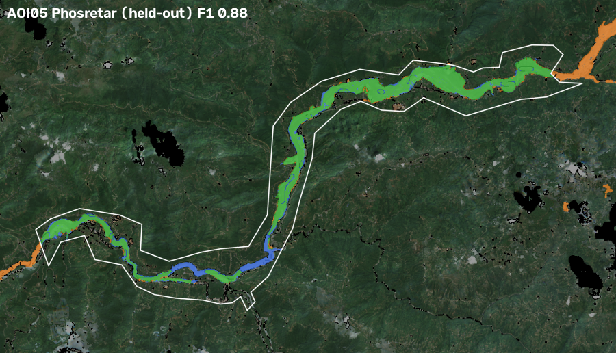
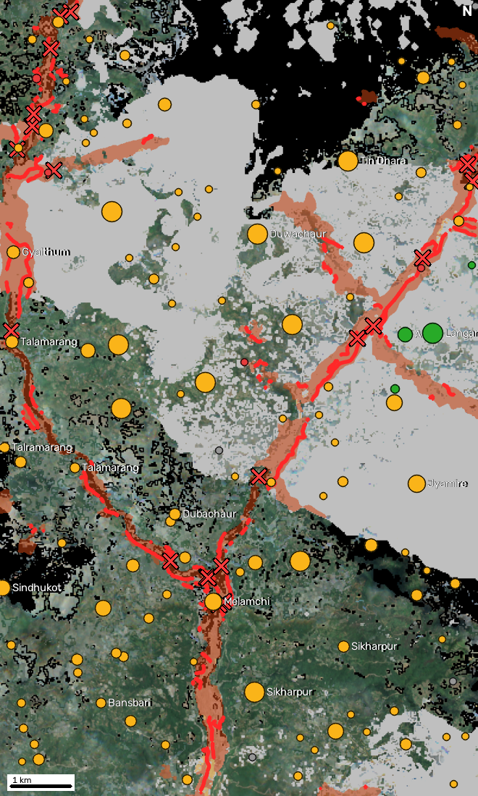
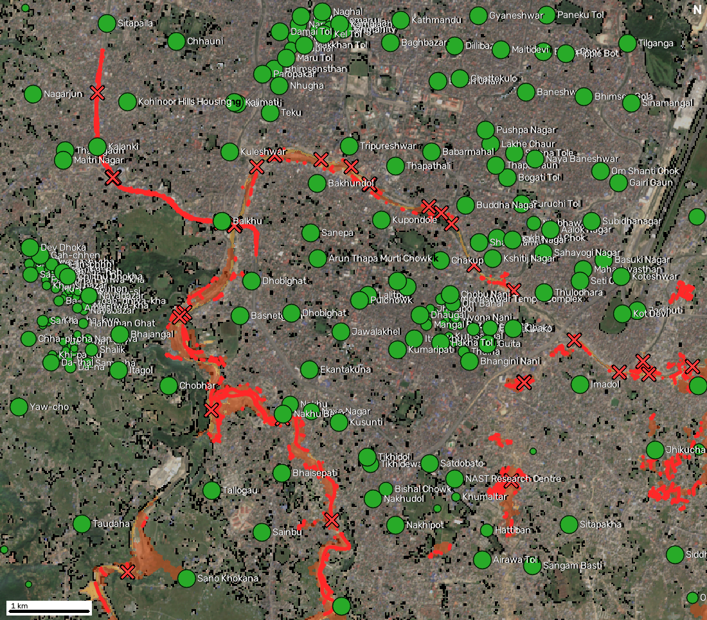

# WaterGuard: mapping flood damage from space

Adil Mahajan.
Code: see README. Case study: Bhote Koshi–Trishuli glacier-outburst flood, Nepal, 25/26 Aug 2026 (Copernicus EMS EMSR927).

## 1. Problem and what we built

When roads, bridges and phone lines fail, rescuers need three answers fast: **where** the flood hit, **what** it damaged and **who** is cut off. WaterGuard answers them for any area and date, from free satellite data only:

- an **impact map** of flooded and debris-covered ground, fusing Sentinel-1 radar (cloud-proof), Sentinel-2 optical change (where clear) and the Copernicus DEM (where a flood can physically reach);
- a **damage overlay** of pre-event OpenStreetMap buildings, roads, bridges and health facilities;
- a **cut-off analysis** that removes impacted road segments and damaged bridges from the road graph and finds settlements that lost every link to a town, a health facility or the wider network;
- a **situation-report copilot** (English + Nepali) that answers only from these results, with an automatic number checker;
- a **dashboard**, a printable **one-page situation report** (EN/NE) and a **flood-path tracer** (bonus).

## 2. Data rules

| Input | Source | Role |
|---|---|---|
| Sentinel-1 RTC (VV, VH) | Microsoft Planetary Computer (Meru Labs fallback) | change detection, all orbit tracks |
| Sentinel-2 L2A | Planetary Computer | change detection where clear |
| Copernicus DEM GLO-30 | Planetary Computer | HAND, slope, layover/shadow, flow paths |
| OpenStreetMap, snapshot 24 h before the event | ohsome API v2 (HeiGIT) | buildings, roads, bridges, places, health facilities |

EMS maps are used **only** to score results (`waterguard/validate.py`, never imported by the pipeline). Each run audits its OSM snapshot: it fails if any feature was edited after the snapshot time (case study: 0 edited; latest edit in snapshot 26 Jul 2026). No training dataset is used (we chose the copilot as the AI component).

## 3. Method

**3.1 Terrain.** GLO-30 is hydrologically conditioned (least-cost breaching) with WhiteboxTools. We derive D8 flow directions, a stream network (≥ 2 km² upstream area), **HAND** (height above nearest drainage), slope and aspect.

**3.2 Radar change (Sentinel-1).** For every orbit track with an image after the event, the first post-event image is compared with up to five earlier images of the **same track** (same viewing geometry, 12-day repeat), as recommended for SAR change detection. After 5×5 multilooking (OpenCV), each pixel gets a z-score |post − mean(pre)| / std(pre), with a 0.75 dB std floor. Pixels that normally fluctuate need a bigger change to count. Debris can brighten (boulders) or darken (mud, water), so the absolute value is used. Pixels in **layover or shadow** for that track, predicted from slope/aspect and the pass direction, are excluded. Tracks and polarisations are averaged. Open water is VV < −18 dB and VH < −25 dB.

**3.3 Optical change (Sentinel-2).** Monsoon cloud rarely leaves a clean scene, so we build per-pixel cloud-free median composites from the Scene Classification Layer over 45 days before and 40 days after the event. Reflectance is harmonised for processing baseline ≥ 04.00. Stripped vegetation shows as NDVI loss and new water or wet sediment as NDWI gain.

**3.4 Fusion (OpenCV).** A pixel is impacted if it is on the valley floor (HAND ≤ 80 m) **and** shows change: optical where both composites are clear, radar elsewhere (smoothed |z| ≥ 1.0). Then come morphological opening/closing, a rule that patches must touch the river channel (a flood arrives from the river, not mid-slope) and a 2 ha minimum. Clear-sky ground that is bare or water after the event and connected to ≥ 5 ha of detected change is added. This captures the riverbed and gravel bars the surge ran through, which had no vegetation to lose. Ground that was bare *before* the event too, added only by this connectivity, is kept as a separate **lower-confidence riverbed** class.

**3.5 Damage.** A building, bridge or health facility is *likely affected* if it intersects impact and *possibly affected* within 20 m. We also report road length inside impact, by class.

**3.6 Who is cut off.** OSM roads become a graph (every vertex a node, so mid-way junctions count) for two networks: *vehicle* (motorable roads and tracks) and *foot* (plus paths, which matter in the hills). Impacted segments and likely-damaged bridges are removed. Destinations are towns/cities, health facilities and road exits at the area's edge. Settlements are OSM places plus clusters of ≥ 8 buildings without a named place, so unmapped hamlets count. Each settlement is tested through up to 25 of its own buildings, each snapped to its nearest road, so one flooded junction next to the place's map point cannot strand a whole suburb. Buildings are put in a canonical (coordinate) order before sampling, so an independent re-run samples the same houses: an independent verifier caught this when its fresh OSM download arrived in a different order and Syabru Bensi's estimate came out 988 instead of 1,200 people stranded. A settlement is **cut off** if none of its buildings can reach any destination after the flood, and **partly cut** if some can't or it lost a destination type. We report the share of its buildings with no road left and **people stranded** = people × that share. We also compute road distance to the nearest health facility before and after. People = buildings × 4.37 (Nepal 2021 census household size), always labelled as an estimate.

**3.7 Flood path (bonus).** From any clicked point, snapped to the nearest stream, we follow D8 steepest descent downstream and list settlements within 400 m of the path whose lowest part is ≤ 80 m above the river, ordered by distance. Times use an *assumed* 4 m/s surge and are labelled as such.

**3.8 AI component: situation-report copilot.** An LLM (Amazon Bedrock, default Amazon Nova Pro; or any OpenAI-compatible model) with six read-only tools over the run's results. Rules: answer in the user's language (English/Nepali) and copy every number from a tool result. A **verifier** extracts every number from the draft (ASCII or Devanagari digits) and checks it against the tool results of that conversation. On failure the model gets one retry naming the bad numbers; numbers that still fail are masked `[unverified]` and flagged in the UI. Without an LLM, a deterministic router answers the common questions from the same tools. The one-page report is template-based, so its numbers are exactly the pipeline's.

## 4. Case study: EMSR927 comparison

EMS delivered maps for four areas (AOI01 Syapru Besi, AOI02 Timure, AOI03 Bidur, AOI05 Phosretar; AOI04/06 were cancelled for cloud). EMS mapped the event as debris-flow/landslide footprints ("observed event"), plus graded building and bridge damage from very-high-resolution optical imagery. We score inside each AOI, excluding EMS "not analysed" areas.

**Honest protocol.** Thresholds were tuned on **AOI01 + AOI02 only**. AOI03 and AOI05 are **held out**. The patch-size limits were set with false-alarm tests that use no EMS data: a *placebo date* (2 ha minimum patch) and an unaffected *control tributary*, Tadi Khola (5 ha minimum seed for riverbed growth; with 2 ha seeds, growth ran up Tadi's pre-existing gravel bed, 180 ha of false impact). As a baseline we mark the whole valley floor (HAND ≤ 80 m) as hit. This shows how much the satellite change evidence adds, since EMS AOIs are drawn tightly around the damaged valley.

RESULTS_TABLE

**Do the results depend on the EMS calibration?** Hardly. With the thresholds written *before* any EMS label was looked at (HAND ≤ 60 m, NDVI drop 0.10, radar |z| ≥ 1.1, 15 px smoothing) plus the riverbed rule, F1 on AOI01/02/03/05 is **0.89 / 0.80 / 0.92 / 0.86**, against 0.94 / 0.90 / 0.92 / 0.87 tuned (same cached features). The riverbed rule is the part that matters (without it: 0.83 / 0.53 / 0.85 / 0.54). It has a physical basis: a debris-flow channel is bare ground after the event, whether or not it was vegetated before. EMS maps never enter a run: they are read only by `validate.py`.

 

*Held-out areas. Green = mapped by both, orange = only WaterGuard, blue = only EMS, white = EMS area outline. Orange outside the outline is outside what EMS analysed (e.g. the Tadi Khola, bottom right in Bidur: see Limitations).*

**False-alarm tests** (should map ~nothing):

FALSE_ALARM_TABLE

**Copilot evaluation** (`scripts/eval_copilot.py`, Amazon Nova Pro on Bedrock, Syapru Besi run, 13 questions: 9 English, 4 Nepali; transcript in `docs/copilot_eval.json`). **13 of 13 answers fully verified (106 numbers), no retries.** In an earlier run, one answer (a 5-line situation report) multiplied buildings by household size on its own. The verifier rejected the number, the retry repeated it and it was masked as `[unverified]`, so no invented figure reached the user. The pipeline now computes that figure itself (`people_est_in_likely_affected_buildings`). Asked "How many people died?", the copilot says the maps contain no casualty data and gives no number. Each answer takes 2–7 s.

**Another event, untouched by tuning: Melamchi flood, 15 Jun 2021.** We ran the same code, with no changes, on a different year, catchment and Sentinel-2 processing baseline (bbox 85.54–85.62 E, 27.80–27.92 N; 266 s cold). It mapped 954 ha of impact, 855 buildings likely affected and 20 bridges likely damaged. **Melamchi Bazar**, the town devastated in that flood, loses road access to its health post (12 km before, no route after), with 56% of its buildings left without a road. The first post-event radar image was 20 Jun 2021, five days after the flood. We have no EMS-style reference for this event, so this check is qualitative.

**A flat, urban flood: Kathmandu Valley, 27–28 Sep 2024.** This is the opposite of a Himalayan gorge, and it exposed two weaknesses that we fixed before freezing the code. First, roofs and streets are "bare" in Sentinel-2, so riverbed growth ran through the city (1,062 ha, 34,502 buildings "hit"). Pre-event OSM building footprints now block riverbed growth: 281 ha, along the Bagmati, Nakkhu, Balkhu and Manohara, the rivers that overflowed. Second, one flooded junction next to a place's map point stranded whole suburbs (Balkhu, Kalanki). The building-sampled cut-off test (3.6) fixed that: no settlement is cut off in the redundant city grid, and about 7,200 people's buildings lost road access, mostly near the Manohara. Both fixes cost a little on the EMS areas (Phosretar destroyed-building recall 96% → 90%). We kept them, because a judge's area can be anywhere.

 

## 5. Dashboard, report and copilot

The dashboard (`python -m waterguard.server`) takes a drawn box and a date and shows progress, then layers: impact, Sentinel-2 before/after, radar change, buildings hit, roads cut, bridges, and settlements coloured by road status. A side panel has the situation tiles, cut-off and bridge lists, the copilot, the one-page report (EN/NE), the flood-path tool and a *Basis* tab. That tab lists every satellite image used and the OSM audit.

## 6. Limitations: what WaterGuard cannot do

- **No early warning.** Sentinel-1 revisits each track every 12 days (two tracks here, so a new look every few days) and Sentinel-2 every 5 days, cloud permitting. WaterGuard maps damage *after* the fact. It cannot warn of a glacier collapse minutes ahead. In the case study the first post-event radar image came about 2.6 days after the flood (28 Aug 12:21 UTC).
- **Radar blind spots.** Steep slopes facing towards or away from the satellite (layover/shadow) cannot be assessed from that track. We mask them rather than guess. Narrow gorges are hard at 10 m.
- **Radar-decided impact is coarser.** Under cloud, the radar evidence is smoothed over ~200 m to beat speckle, so radar-decided patches come out as wider bands than optical ones (visible in the Melamchi run).
- **Clouds.** During the monsoon, optical change is available only where the composites found clear pixels. Elsewhere the coarser radar evidence decides. The Basis tab reports the split.
- **Building-level damage is inferred, not seen.** At 10 m, a building on mapped impact is *likely affected*. We cannot tell destroyed from damaged. EMS used 0.3–0.5 m imagery for that.
- **OSM completeness.** Unmapped roads, trails, bridges or buildings are invisible to the damage and cut-off analysis, and connectivity is only as good as the pre-event map. Areas outside OSM coverage give "no mapped road".
- **People are estimates** (buildings × 4.37 household size): it counts non-residential buildings, ignores seasonal migration and is not a census.
- **The area boundary matters.** "Cut off" means no route to a town, a health facility or a road leaving the drawn area. A small box can hide a detour that exists outside it.
- **Tributary riverbeds.** Bare gravel that connects to detected change is added to the impact map. At a confluence this can run up a tributary's riverbed that was already bare before the event. In the Bidur run the Tadi Khola bed is flagged this way, and from the allowed data we cannot tell whether a monsoon high flow hit it. Such pixels are a separate, lower-confidence class (yellow on the map) and are reported as such.
- **Cities.** Flooding between buildings is hard to see from radar (double bounce) and 10 m optical pixels mix roofs and water. In Kathmandu we map flooding along the river corridors, not street-level water.
- **Valley-floor prior.** Impact is only mapped below 80 m HAND. Landslides high on the slopes, which EMS also mapped, are out of scope.
- **Tuned on one event.** Thresholds come from two EMSR927 areas and were checked on two held-out areas plus false-alarm tests, but not on other flood types (e.g. plains riverine floods).
- **The copilot can still be wrong in words.** The verifier guarantees numbers, not the reasoning around them. The Nepali report templates have not yet been reviewed by a native speaker.
- **Run time.** A cold run over about 30 km² takes 3–5 minutes, almost all of it downloading imagery from Planetary Computer.

## 7. Attribution and citations

Contains modified Copernicus Sentinel data 2026. Produced using Copernicus WorldDEM-30 © DLR e.V. 2010–2014 and © Airbus Defence and Space GmbH 2014–2018 provided under COPERNICUS by the European Union and ESA; all rights reserved. © OpenStreetMap contributors (ODbL), via the ohsome API (HeiGIT). Validation only: European Union, Copernicus Emergency Management Service data (EMSR927). Lindsay, J. B. (2016), *Whitebox GAT*, Computers & Geosciences 95. Nobre, A. D. et al. (2011), HAND, *J. Hydrology* 404. National Statistics Office Nepal (2021), *National Population and Housing Census 2021* (average household size 4.37).
